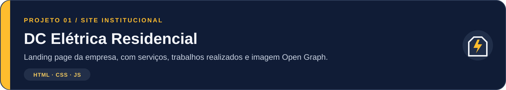
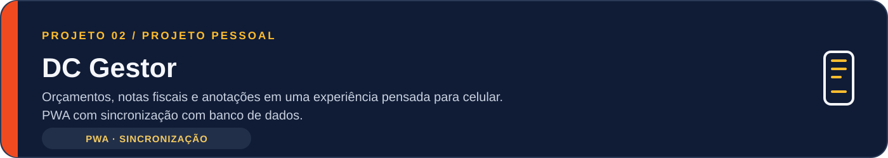
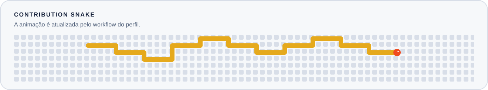

  

<h1 align="center">Gustavo Vicente Cardoso</h1>

  

  
  
  

---

### Sobre mim

Sou estudante de desenvolvimento e aprendo criando. Hoje estou cuidando de uma landing page para a DC Elétrica Residencial e construindo o DC Gestor, uma ferramenta pessoal pensada para o celular.

Estudo **HTML5, CSS3, Tailwind CSS e JavaScript** e vou ampliando o que consigo fazer em cada projeto.

### Tecnologias

  

### Projetos

  

  
  

  

  
  

### GitHub Stats

  
  

### Streak

  

### Activity Graph

  

### GitHub Trophies

  

### Snake Contribution

  <picture>
    <source media="(prefers-color-scheme: dark)" srcset="./assets/github-contribution-grid-snake-dark.svg" />
    <source media="(prefers-color-scheme: light)" srcset="./assets/github-contribution-grid-snake.svg" />
    
  </picture>

  

