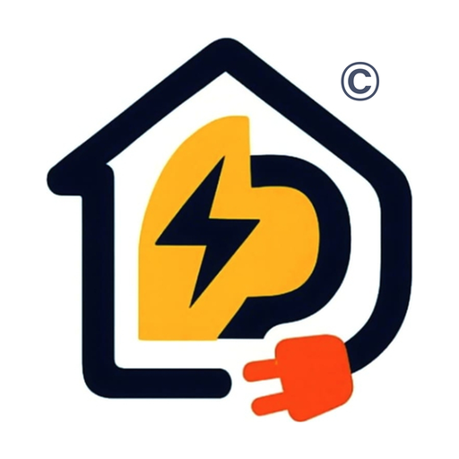

  

  

<h1 align="center">Gustavo Vicente Cardoso</h1>

  

  
  
  

---

### Sobre mim

Sou desenvolvedor estudante e gosto de aprender colocando ideias em prática. Tenho trabalhado em projetos próprios que resolvem necessidades reais — de uma presença digital para uma empresa a uma ferramenta de organização feita para o celular.

No momento, estudo **HTML5, CSS3, Tailwind CSS e JavaScript** e sigo evoluindo cada projeto um passo de cada vez.

### Tecnologias

  

### Projetos

<table>
  <tr>
    <td width="50%" valign="top">
      

      <h3 align="center">DC Elétrica Residencial</h3>
      
Landing page da empresa, com apresentação dos serviços e trabalhos realizados. O site também conta com imagem Open Graph para prévias ao compartilhar o link.

      

        
        
      

    </td>
    <td width="50%" valign="top">
      
🧾

      <h3 align="center">DC Gestor</h3>
      
Projeto pessoal para organizar orçamentos, notas fiscais e anotações. Está sendo pensado principalmente para uso no celular, com PWA e sincronização com banco de dados.

      

        
        
      

    </td>
  </tr>
</table>

### GitHub Stats

  
  

### Streak

  

### Activity Graph

  

### GitHub Trophies

  

### Snake Contribution

  <picture>
    <source media="(prefers-color-scheme: dark)" srcset="https://raw.githubusercontent.com/gustavocardosotec/gustavocardosotec/output/github-contribution-grid-snake-dark.svg" />
    <source media="(prefers-color-scheme: light)" srcset="https://raw.githubusercontent.com/gustavocardosotec/gustavocardosotec/output/github-contribution-grid-snake.svg" />
    
  </picture>

  Gustavo Vicente Cardoso · da landing page ao próximo projeto.

